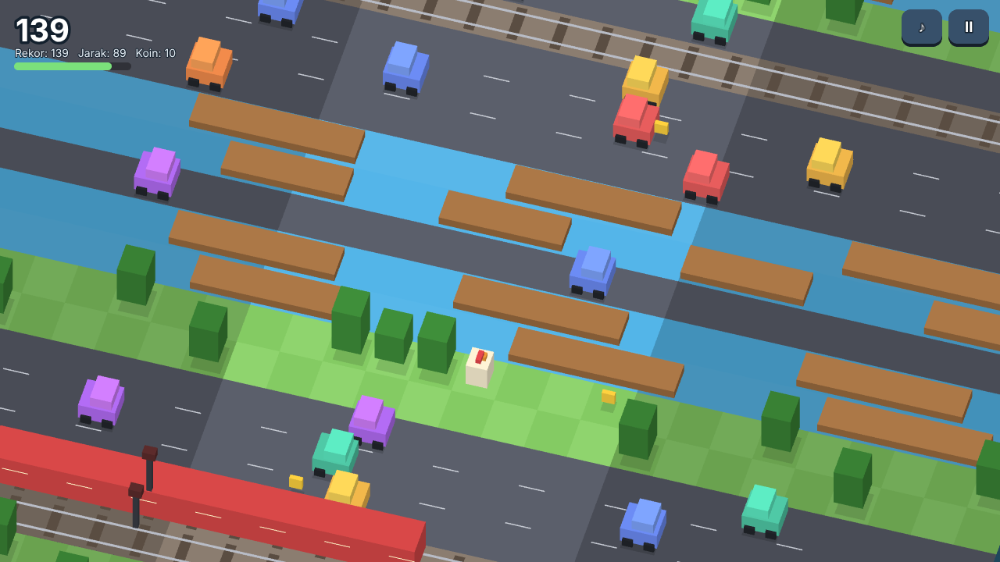
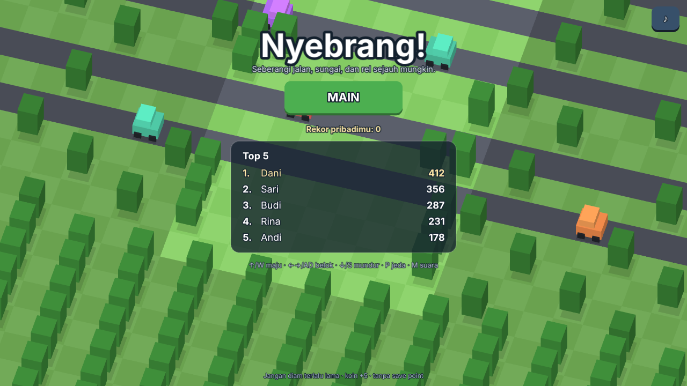
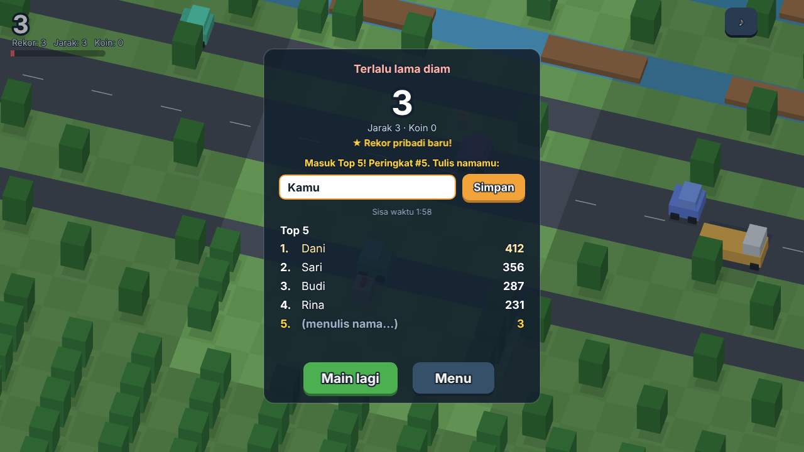
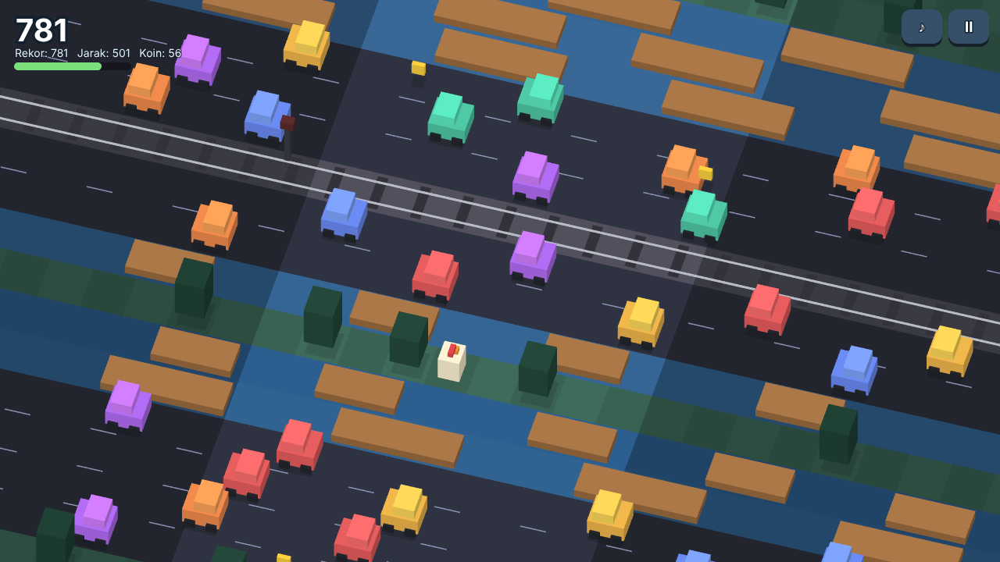
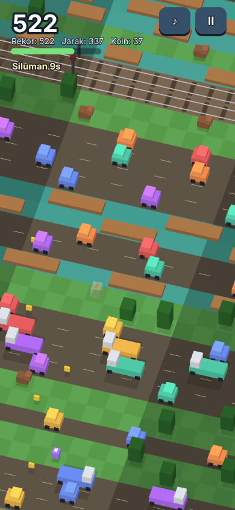
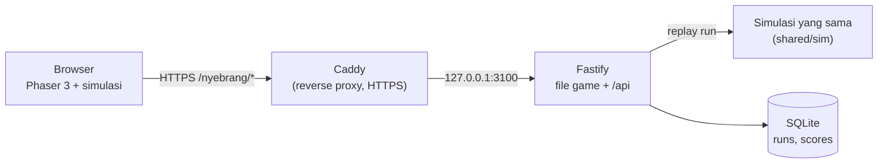

# Nyebrang!

**Nyebrang! adalah game arkade endless menyeberang jalan di browser.** Lompat maju melewati jalan raya, sungai, dan rel kereta sejauh mungkin. Tidak ada save point dan tidak ada garis akhir: satu nyawa, mati berarti mulai lagi dari nol. Lima skor tertinggi dari semua pemain tampil di leaderboard, dan pemiliknya bisa menuliskan namanya.

Tampilan isometrik ala Crossy Road, digambar dari bentuk sederhana tanpa file gambar. Genre terinspirasi Frogger/Varmintz; seluruh karakter, nama, dan asetnya orisinal.

**Main sekarang:** https://72-62-122-35.sslip.io/nyebrang/ (server uji coba)



## Fitur

| | |
|---|---|
| **Endless** | Dunia dibangkitkan terus dari seed: rumput berpohon, jalan raya (mobil & truk), sungai (menumpang kayu), rel kereta dengan lampu peringatan (mulai baris 50), anjing penjaga yang berpatroli (mulai baris 120). |
| **Makin sulit** | Kecepatan & kepadatan naik seiring jarak, dibatasi 2,5x supaya tetap bisa dimainkan. Selalu ada jalur yang bisa ditembus di antara pohon. |
| **Jangan diam** | Bar waktu di bawah skor berkurang terus dan hanya terisi saat mencapai baris baru (8 detik, menyusut sampai 5 detik). |
| **Koin & power-up** | Koin +5 poin. Power-up: **Siluman** (kebal kendaraan 5 dtk), **Tambah waktu** (bar penuh), **Magnet** (koin tertarik 8 dtk), **Slow-mo** (dunia melambat 50%, 5 dtk). |
| **Leaderboard Top 5** | Posisi dikunci saat game over. Pemain punya 2 menit untuk menulis nama; lewat dari itu tercatat sebagai `ANONIM`. Rekor pribadi disimpan di browser. |
| **Anti-cheat** | Server memutar ulang setiap run dari seed + log input. Skor yang tidak cocok, input yang tidak mungkin, atau run yang lebih cepat dari waktu nyata ditolak. |
| **4 tema** | Desa, Kota, Hutan, dan Malam bergantian tiap 150 baris. |
| **Desktop & ponsel** | Keyboard atau sentuh (ketuk & swipe), tampilan menyesuaikan lebar layar, efek suara sintetis yang bisa dibisukan. |

| Menu & Top 5 | Masuk Top 5: tulis nama |
|---|---|
|  |  |

| Tema Malam (baris 450+) | Ponsel, power-up Siluman aktif |
|---|---|
|  |  |

## Cara main

| Aksi | Keyboard | Layar sentuh |
|---|---|---|
| Maju | `↑` / `W` | Ketuk |
| Belok kiri / kanan | `←` `→` / `A` `D` | Swipe kiri / kanan |
| Mundur (maks. 4 baris) | `↓` / `S` | Swipe bawah |
| Jeda | `P` / `Esc` (otomatis saat pindah tab) | Tombol `II` |
| Suara | `M` | Tombol `♪` |

**Skor** = baris terjauh + 5 per koin. Mundur tidak mengurangi skor, tapi juga tidak menambah.

| Penyebab mati | Keterangan |
|---|---|
| Tertabrak kendaraan / kereta | Perhatikan lampu merah berkedip di rel: kereta segera lewat |
| Tercebur ke sungai | Melompat ke air yang tidak ada kayunya |
| Hanyut terbawa arus | Kayu membawa pemain keluar dari area main |
| Digigit anjing penjaga | Anjing berpatroli bolak-balik di lajur rumput tertentu |
| Terlalu lama diam | Bar waktu habis |

## Teknologi

Phaser 3 · TypeScript · Vite · Node.js 22 · Fastify 5 · SQLite (`node:sqlite`, tanpa dependensi native) · Vitest · systemd + Caddy

## Arsitektur



Logika game (generator dunia, tabrakan, skor) ada di `shared/sim` dan dipakai oleh **klien dan server**. Simulasinya deterministik: 60 tick per detik, RNG ber-seed, tanpa `Math.random()`. Karena itu server bisa memainkan ulang run persis sama hanya dari seed dan daftar input `[tick, arah]`, lalu menghitung skornya sendiri.

Alur satu run:

1. `POST /api/runs`: server memberi `runId`, `seed`, dan token HMAC.
2. Pemain bermain; klien mencatat setiap lompatan yang diterima simulasi.
3. Saat mati, `POST /api/runs/:id/finish` mengirim log input. Server me-replay, mencocokkan skor & jumlah tick, dan mengecek tick tidak melebihi waktu nyata.
4. Jika lolos 5 besar, skor langsung dicatat dan klien mendapat `claimToken` sekali pakai.
5. `POST /api/leaderboard/claim` menulis nama (maks. 2 menit).

---

## Instalasi (komputer lokal)

### 1. Prasyarat

| Perangkat | Versi | Cek |
|---|---|---|
| [Node.js](https://nodejs.org) | 22.13 atau lebih baru (butuh `node:sqlite`) | `node -v` |
| npm | ikut Node.js | `npm -v` |
| [Git](https://git-scm.com) | apa saja | `git --version` |

Tidak perlu database server: SQLite sudah bawaan Node.js.

### 2. Ambil kode & pasang dependensi

```bash
git clone https://github.com/fakhruladani/Nyebrang.git nyebrang
cd nyebrang
npm install
```

### 3. Jalankan mode development

Buka dua terminal:

```bash
npm run dev:server     # API di http://127.0.0.1:3100
npm run dev:client     # game di http://localhost:5173/nyebrang/
```

Buka **http://localhost:5173/nyebrang/**. Vite meneruskan `/nyebrang/api/*` ke server, dan perubahan kode langsung termuat ulang. Database dibuat otomatis di `server/data/game.db`.

### 4. Jalankan mode produksi (opsional)

```bash
cp .env.example .env          # Windows PowerShell: Copy-Item .env.example .env
# isi RUN_TOKEN_SECRET di .env (openssl rand -base64 32)
npm run build
npm start                     # buka http://127.0.0.1:3100/nyebrang/
```

---

## Environment variables

| Variabel | Wajib | Keterangan |
|---|---|---|
| `RUN_TOKEN_SECRET` | ✔ (production) | Kunci HMAC token run. Rahasia, jangan di-commit. Saat development dibuat acak otomatis |
| `PUBLIC_ORIGIN` | | Origin publik, mis. `https://domainmu.com`. Dipakai CSP `connect-src` |
| `PUBLIC_BASE` | | Prefix path game. Default `/nyebrang/` |
| `HOST`, `PORT` | | Default `127.0.0.1:3100` |
| `DB_PATH` | | File SQLite. Default `server/data/game.db` |
| `ADMIN_TOKEN` | | Mengaktifkan endpoint moderasi `/api/admin/*`. Kosong = mati |
| `CLAIM_WINDOW_MS` | | Waktu menulis nama. Default `120000` (2 menit) |

## Perintah

| Perintah | Fungsi |
|---|---|
| `npm run dev:client` · `npm run dev:server` | Development (Vite + server dengan auto-reload) |
| `npm run build` lalu `npm start` | Build & jalankan mode produksi |
| `npm run typecheck` | Cek TypeScript klien & server |
| `npm test` | Semua test |

Test mencakup RNG & generator dunia (deterministik, jalur selalu tembus, batas kesulitan), simulasi (cooldown, mati karena diam), **replay** (bot bermain lalu hasilnya diputar ulang harus identik, input palsu ditolak), bot keseimbangan, serta API: run valid, skor palsu, speed-hack, token salah, klaim nama (kata kasar, kedaluwarsa jadi ANONIM, sekali pakai), urutan Top 5, admin, dan header CSP.

---

## Deploy ke server

Game ini dirancang berjalan **berdampingan dengan aplikasi lain** di satu VPS, di path `/nyebrang/` pada domain yang sama, dengan proses, user Linux, port, dan database sendiri.

```bash
# sekali saja (di server, butuh sudo)
sudo bash ~/nyebrang-src/deploy/setup-vps.sh
# setiap update (dari laptop)
bash deploy/deploy.sh
```

Panduan lengkap (user layanan, systemd ber-hardening, rute Caddy, moderasi, backup, rollback): **[docs/DEPLOY.md](docs/DEPLOY.md)**.

## Struktur proyek

```
client/src/scenes/   Boot, Menu, Game, GameOver
client/src/render/   proyeksi isometrik, palet tema, WorldRenderer
client/src/systems/  input (keyboard/sentuh), efek suara, localStorage
shared/src/sim/      world (generator), simulation (aturan game), replay
server/src/          app, config, db (SQLite), token (HMAC), names (filter nama)
server/src/routes/   runs, leaderboard, admin
deploy/              nyebrang.service, Caddyfile.snippet, setup-vps.sh, deploy.sh
tests/               Vitest + bot pemain untuk uji keseimbangan & replay
docs/                DESAIN.md (keputusan & angka game), DEPLOY.md, CHANGELOG.md
```

## Keamanan

- **Skor diverifikasi server**, bukan dipercaya dari klien: replay penuh, token HMAC per run, satu kali kirim, batas waktu run 3 jam, dan tick tidak boleh melebihi waktu nyata + 2 detik.
- **Nama hanya dirender sebagai teks canvas**, tidak pernah sebagai HTML. Nama dibatasi 3–12 huruf/angka/spasi dan disaring dari kata kasar.
- **CSP ketat**: `connect-src` hanya mengizinkan path API game, sehingga skrip di halaman game tidak bisa memanggil API aplikasi lain di domain yang sama. Frame, object, dan form dimatikan.
- Rate limit per IP: 60 run/jam, 60 pengiriman/jam, 20 klaim nama/10 menit. Alamat IP hanya disimpan sebagai hash.
- Di server: layanan berjalan sebagai user tanpa login, dibatasi RAM 256 MB & CPU 50%, filesystem read-only kecuali folder database.

**Batasan yang disadari:** game berjalan di browser, jadi bot yang bermain lewat input sah tetap tidak bisa dibedakan dari manusia. Entri mencurigakan bisa dihapus manual lewat endpoint admin.

Detail desain: [docs/DESAIN.md](docs/DESAIN.md).

## Troubleshooting

| Masalah | Solusi |
|---|---|
| `No such built-in module: node:sqlite` | Node.js terlalu lama. Pakai 22.13 atau lebih baru |
| Leaderboard "tidak tersedia" / "Mode offline" | Server API tidak berjalan atau tidak terjangkau. Game tetap bisa dimainkan, skor tidak dikirim |
| "Skor ditolak server" | Run tidak lolos verifikasi: kode klien diubah, atau browser masih memakai versi game lama setelah update (muat ulang halaman) |
| Port 3100 dipakai | Ubah `PORT` (dan target proxy di `client/vite.config.ts` saat development) |
| Halaman kosong setelah `npm start` | Buka dengan prefix: `http://127.0.0.1:3100/nyebrang/` |
| `RUN_TOKEN_SECRET wajib di production` | Isi variabel itu di `.env` atau environment |

## Lisensi

Dirilis di bawah [Lisensi MIT](LICENSE). Kode boleh dipakai, diubah, dan dibagikan ulang, asalkan pemberitahuan hak cipta tetap dicantumkan.

Nyebrang! tidak berafiliasi dengan Varmintz, Frogger, atau Crossy Road; ketiganya hanya referensi genre.
